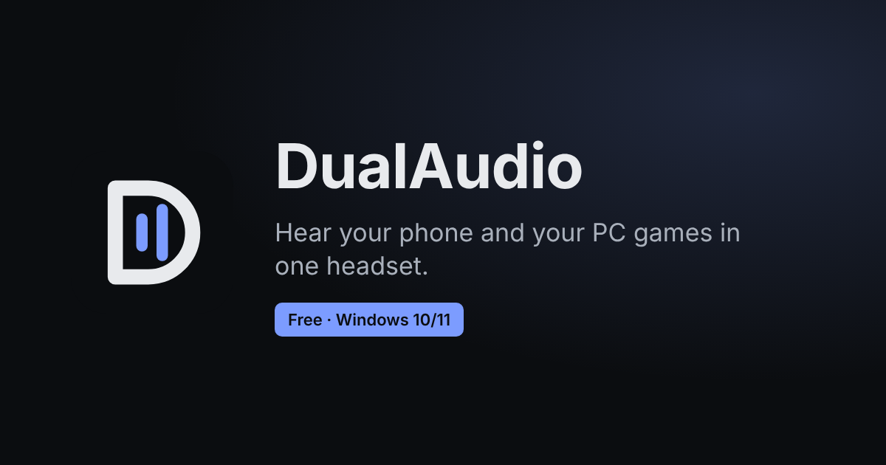
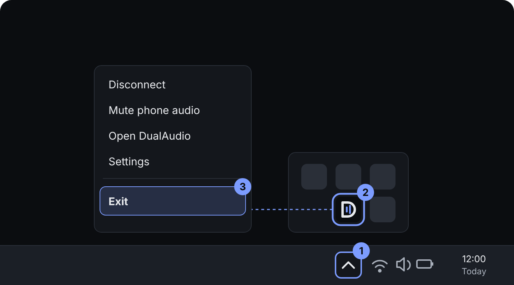

<p align="center">
  
</p>

<h1 align="center">DualAudio</h1>

<p align="center">Hear your phone and your PC in the same headset.</p>

DualAudio is a small Windows 11 tray app. Your phone streams its media audio (TikTok, YouTube, music, Discord on the
phone…) to your PC over Bluetooth, and Windows plays it through the headset you already use for games, mixed with the
game audio. The phone gets its own volume and mute, so the game is never touched.

- Uses the built-in Windows Bluetooth audio receiver (A2DP sink). No drivers, no admin rights, no virtual cables.
- Phone volume and mute separate from game audio, with global shortcuts (Ctrl+Alt+M, Ctrl+Alt+PgUp/PgDn) that work in
  games without popping up a window.
- Reconnects by itself after drops, sleep, Bluetooth on/off and adapter unplug. "Fix audio" for the rare silent connection.
- Media audio only. Phone calls and the microphone are not forwarded.

<p align="center">
  
</p>

## Requirements

- Windows 11 (or Windows 10 version 2004 / build 19041 or later), 64-bit
- A Bluetooth adapter (built in or USB)
- A phone paired with the PC in **Settings > Bluetooth & devices** (iPhone or Android)

## Install

1. Download **`DualAudioApp-win-Setup.exe`** from the
   [latest release](https://github.com/rye-to-rye/DualAudio/releases/latest/download/DualAudioApp-win-Setup.exe).
2. Run it. It installs for your user only (no admin prompt) and starts DualAudio.
3. Follow the four setup steps: checks, your PC's Bluetooth name, pick your phone, play something.

**SmartScreen:** the installer isn't code-signed yet, so Windows may show "Windows protected your PC". Click
**More info**, then **Run anyway**.

Prefer no installer? Download `DualAudioApp-win-Portable.zip` from the same release, unzip it anywhere and run
`DualAudio.exe`.

## Where it lives

DualAudio runs in the system tray. Closing the window hides it; it keeps your phone connected. Click the tray icon
for volume, mute and connect/disconnect; right-click it for Settings and **Exit**.

<p align="center">
  
</p>

Files:

| What | Where |
|------|-------|
| The app (installed copy) | `%LOCALAPPDATA%\DualAudioApp\current\DualAudio.exe` |
| Settings and logs | `%LOCALAPPDATA%\DualAudio\` (`settings.json`, `logs\`) |
| Start with Windows | `HKCU\Software\Microsoft\Windows\CurrentVersion\Run`, value `DualAudio` (only if you turn it on) |

Uninstall from **Settings > Apps > Installed apps > DualAudio**. That removes the app and the start-with-Windows
entry. Your settings and logs in `%LOCALAPPDATA%\DualAudio` stay; delete that folder too if you want everything gone.

## Updates

The installed app checks GitHub Releases one minute after it starts and then every 12 hours, and downloads a new
version in the background. When it's ready you see a small "Update ready" note on the dashboard and in the tray
tooltip, with **Restart now** and **Later**. DualAudio never restarts on its own (it won't interrupt a game): if you
choose Later, the update is installed the next time you exit DualAudio. **Settings > About > Check for updates** checks
right away. No account, no token, nothing is sent except the request for the release list. Being offline is fine.

## Building from source

Needs the .NET 10 SDK on Windows.

```powershell
git clone https://github.com/rye-to-rye/DualAudio.git
cd DualAudio
dotnet build DualAudio.sln
dotnet test DualAudio.sln --filter "Category!=Hardware"
dotnet run --project src/DualAudio.App
```

A copy started with `dotnet run` never checks for updates. Hardware tests need a paired phone in range:
set `DUALAUDIO_HW_TESTS=1` and run `dotnet test`. The installer is built with `./build/pack.ps1` (see
[RELEASING.md](RELEASING.md)).

Project layout and design notes: [docs/architecture.md](docs/architecture.md). Hardware test log:
[docs/test-log.md](docs/test-log.md).

## Releasing

Bump nothing by hand: tag and push.

```powershell
git tag v0.1.1
git push origin v0.1.1
```

GitHub Actions builds, tests, packs and publishes the release with the installer and the update feed. Details and how
to test an update locally: [RELEASING.md](RELEASING.md).
