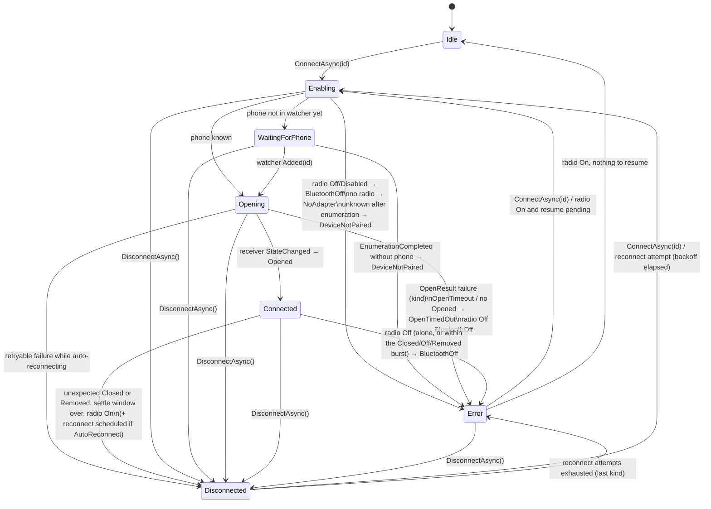

# DualAudio architecture

## Projects

| Project | TFM | Role |
|---------|-----|------|
| `src/DualAudio.Core` | `net10.0` | Interfaces, models, connection state machine, reconnect policy, settings model, phone-session rule. No Windows references (enforced by `CoreIsPlatformIndependentTests`). |
| `src/DualAudio.Infrastructure` | `net10.0` | Settings persistence, logging setup (later task). |
| `src/DualAudio.Platform.Windows` | `net10.0-windows10.0.19041.0` | WinRT / CoreAudio / Win32 adapters implementing Core interfaces (later task). |
| `src/DualAudio.App` | `net10.0-windows10.0.19041.0` (WPF) | Tray UI, DI composition root (later task). |
| `tests/DualAudio.Core.Tests` | `net10.0` | xUnit + NSubstitute + FluentAssertions 7.x. |
| `tools/DualAudio.Probe` | `net10.0-windows10.0.19041.0` | Phase 0 hardware probe. |

Dependencies point inward: App → Infrastructure, Platform.Windows → Core.

## Core interfaces (implemented in Platform.Windows / Infrastructure)

| Interface | Wraps |
|-----------|-------|
| `IBluetoothAudioSourceWatcher` | `DeviceWatcher(AudioPlaybackConnection.GetDeviceSelector())` |
| `IAudioReceiver` | `AudioPlaybackConnection` (TryCreateFromId → StartAsync → OpenAsync → Dispose) |
| `IRadioMonitor` | `Windows.Devices.Radios.Radio` (read-only) |
| `IBluetoothRadioControl` | `Radio.RequestAccessAsync` + `SetStateAsync(On)` — only behind an explicit "Turn on Bluetooth" click |
| `ICapabilityService` | Onboarding checks (`CapabilityReport`) + PC Bluetooth name (`CapabilityService`) |
| `IAudioSessionController` | WASAPI sessions matched by `PhoneSessionMatcher`, on all render endpoints (`NAudioSessionController`) |
| `IOutputDeviceService` | Render endpoints + default-endpoint and device-change notifications, read-only (`OutputDeviceService`) |
| `IHotkeyService` | `RegisterHotKey` |
| `ISettingsStore` | JSON file in `%LOCALAPPDATA%` |
| `IClock` | Time / delays (fake in tests) |

## Connection state machine (`ConnectionCoordinator`)

Rules built in from Phase 0 (`docs/phase0-findings.md`, `docs/test-log.md`):

- **Connected is decided by the receiver's `StateChanged → Opened` event**, not by `State` after
  `OpenAsync` (it briefly reads Closed). If Opened never arrives within `OpenedConfirmationTimeout`
  (5 s), the coordinator reads `State` once: Opened → Connected; otherwise Error(OpenTimedOut).
- **Unexpected Closed after Opened = link lost** (BUG-002 idle drop, phone Bluetooth off). After a
  500 ms settle window the coordinator goes to Disconnected and, if `AutoReconnect`, schedules
  `ReconnectPolicy` (2 s, 4 s, 8 s, 16 s, 30 s cap; `MaxAttempts` default 10; success resets).
  Pausing does not fire Closed, so it doesn't trigger this path.
- **PC Bluetooth off** produces Closed + radio Off + Removed within ~140 ms. The settle window plus the
  radio handler collapse the burst into **one** Connected → Error(BluetoothOff) transition. When the radio
  comes back On, the coordinator resumes (WaitingForPhone until the watcher re-adds the phone).
- **Device names** come from watcher `Added` only; `Updated` is ignored (observed `Name="4"`).
  `PhoneDevice.IsConnected` from the watcher is never used as a signal.
- **User Disconnect** acts immediately: bumps an intent version (stale timers/reconnects become no-ops),
  cancels the reconnect policy and any in-flight `OpenAsync`, then queues the transition to Disconnected.

Concurrency: every transition runs inside one `SemaphoreSlim(1)`. Platform events (any thread) and
timer callbacks enqueue work onto it; double-clicked Connect calls queue up and the repeat is ignored.
`StateChanged` is raised on the transitioning thread; the UI must marshal to its dispatcher.

`Error` states and `Disconnected` after a failed reconnect attempt carry an `ErrorKind`; the UI shows
`ErrorMessages.For(kind)` (title + one actionable sentence; no HRESULTs in titles).

**Auto-connect (`AutoConnectAsync`, start-up and "Phone not found — Retry")** differs from a user `ConnectAsync`:
it waits in WaitingForPhone until the watcher reports the phone (no DeviceNotPaired after enumeration), and
retryable failures (incl. PhoneUnreachable = phone Bluetooth off) go through `ReconnectPolicy` from the first attempt.
It never interrupts a reconnect already running for the same phone. The BUG-001 priming cycle runs as for any connect.

**Gave up (`GaveUp`)**: Error with `GaveUp = true` when the policy runs out (auto-connect or link-loss reconnect), or when
an auto-connect's phone isn't in the watcher once enumeration completes (`DeviceNotFound`). The phone stays the target:
a later watcher `Added` for it starts a fresh attempt; radio Off/On resumes too. User Disconnect clears the target, so
nothing reconnects after it. The UI shows this as the calm "Phone not found — Retry" panel, not the error banner.

`OpenAsync` UnknownFailure with ExtendedError 0x8007001F (ERROR_GEN_FAILURE) maps to `ErrorKind.PhoneUnreachable`
("Can't reach your phone"): on hardware it means phone Bluetooth off, out of range, or not ready yet (BUG-003).
It is retryable exactly like `Unknown`, including the BUG-001 priming reopen retries.

## App (`src/DualAudio.App`)

- `Program.Main`: single instance (named Mutex `Local\DualAudio.SingleInstance.v1`; a second launch sets the
  `Local\DualAudio.Activate.v1` event, which brings the first window to the front), then the Generic Host.
- `AppServices.AddDualAudioApp`: Infrastructure (JSON settings, Serilog to `%LOCALAPPDATA%\DualAudio\logs`),
  `AddWindowsPlatform`, Core (`ConnectionCoordinator` **with** `IAudioSessionController`, `PhoneAudioService`), UI.
  `StartupChecks.Verify` refuses to start if the coordinator lacks the session controller (BUG-001 priming).
- `DualAudioRuntime`: starts phone audio, radio and watcher after all subscribers exist, calls
  `coordinator.AutoConnectAsync(PreferredDeviceId)` when `AutoConnectOnStart`; on exit disposes phone audio,
  then the coordinator (connection closed and disposed, awaited) before the host and the process go away.
- Start-up: `OnboardingPolicy.ShouldShow` (no `PreferredDeviceId`) → `OnboardingWindow`, else the dashboard. Closing
  either window exits; finishing/skipping onboarding opens the dashboard and keeps the connection.
- Onboarding (`OnboardingViewModel`), 4 steps: (1) `ICapabilityService` checks (OS ≥ 19041 + AudioPlaybackConnection,
  radio present, radio On, A2DP sources) — OS and radio On block "Next"; "Turn on Bluetooth" calls
  `IBluetoothRadioControl` (Radio.SetStateAsync) **only from that click**; (2) PC name as phones list it = the NetBIOS
  computer name (`Environment.MachineName`, e.g. "RYELAPTOP"); not the DNS host name ("RyeLaptop") nor the adapter's
  DeviceInformation.Name ("RYELAPTOP- front") + iPhone/Android pairing tips; (3) pick the phone from
  the watcher (resolved names) + optional DualAudio-only nickname; (4) user `ConnectAsync`, success **only** when
  `PhoneAudioService.IsReceivingAudio` turns true for that phone; help after 60 s (keeps waiting). On success it saves
  `PreferredDeviceId`, the nickname and `OnboardingCompleted` (which enables "Skip" if onboarding is shown again).
- Remembered phone: the dashboard saves `PreferredDeviceId` when a connection **succeeds** (enters Connected), and only
  after it has been initialized (not while onboarding runs). The device list shows the saved phone first, by nickname;
  "Forget in DualAudio" removes it and its nickname from settings only (no unpair, no disconnect).
- `DashboardViewModel`: the only place service events are marshalled to the UI dispatcher (`IUiDispatcher`); it
  re-reads service state on each event. All service calls run on the thread pool and never throw into the UI.
- Settings: `JsonSettingsStore` writes `settings.json.tmp` then `File.Replace`; a corrupt file is renamed to
  `settings.json.corrupt-<UTC>.bak` and defaults are used.

## Phone audio session rule (`PhoneSessionMatcher`)

Match on any render endpoint: process image `svchost.exe` **and** DisplayName contains `A2DP SNK`.
The `%b{2EA30F40-6E9F-4709-9327-A4E880941760}` session GUID is reported as extra confirmation only
(`PhoneSessionMatch.PrimaryAndGuid`) and never matches on its own. Never match on PID or "Microphone".

## Phone volume / mute and "receiving audio"

**Platform: `NAudioSessionController`** (`src/DualAudio.Platform.Windows/Audio/`). This class does all of its COM work on one dedicated MTA thread
(`MtaWorker`). Core Audio callbacks (session created, default endpoint changed, endpoint added/removed/state,
session state/expired) only post a rescan to that thread. A rescan enumerates the sessions on every active render
endpoint, keeps the phone sessions, and writes the requested volume/mute to each one whose value differs. It never
writes to a non-phone session. The requested values are remembered, so a session that appears later (reconnect,
new default, new endpoint) gets them too. `PhoneSessionsChanged` fires when the phone session on the default endpoint
appears, disappears, or changes between Active and Inactive. `GetPhoneAudioStatusAsync` returns every phone
session's state plus the default session's peak. When no session exists, it returns `Available = false`.
A change made in the Windows volume mixer is overwritten by the next re-apply.

**Core: `PhoneAudioService`**
- Loads `PhoneVolume`/`PhoneMuted` from `AppSettings` and applies them. Nothing is applied before `InitializeAsync`.
- Persists every change. It re-reads the settings first, so other fields are kept.
- Re-applies the saved values on every transition to Connected.
- While Connected, and only then, it polls the status every 250 ms (the interval is clamped to at least 250 ms).
- `IsReceivingAudio` uses hysteresis. It turns true as soon as the default endpoint's phone session is Active
  with a peak above 0.001 (`PhoneAudioOptions.PeakThreshold`). It turns false only after 10 s with no such peak
  (`PhoneAudioOptions.ReceivingHoldTime`), so the short gaps between videos don't make it flicker. A session going
  Inactive also waits out the 10 s; only a disconnect turns it false immediately.
- While the phone is muted, `IsReceivingAudio` keeps the value it had before the mute. Hardware testing showed
  that Windows reports a muted session as Inactive even though its peak stays above 0. Unmuting starts a fresh
  10 s hold. Limitation: audio that starts while muted is not detected until unmute.
- `IsReceivingAudio` is separate from Connected: a paused phone stays Connected but stops receiving.
- `Changed` follows the coordinator's rules: decided under one lock, raised after release, in order.

`DefaultEndpointMasterVolume` is optional and controls the whole device. It changes the default output's master volume
(game audio too) and is not used for phone volume.
