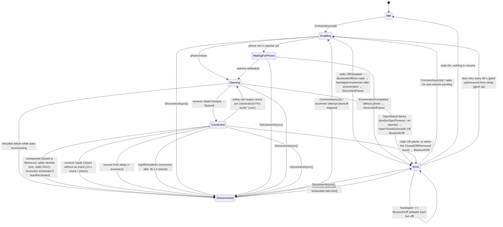

# DualAudio architecture

## Projects

| Project | TFM | Role |
|---------|-----|------|
| `src/DualAudio.Core` | `net10.0` | Interfaces, models, connection state machine, reconnect policy, settings model, phone-session rule. No Windows references (enforced by `CoreIsPlatformIndependentTests`). |
| `src/DualAudio.Infrastructure` | `net10.0` | Settings persistence, logging setup (later task). |
| `src/DualAudio.Platform.Windows` | `net10.0-windows10.0.19041.0` | WinRT / CoreAudio / Win32 adapters implementing Core interfaces (later task). |
| `src/DualAudio.App` | `net10.0-windows10.0.19041.0` (WPF) | Tray UI, windows, hotkey window, DI composition root. |
| `tests/DualAudio.Core.Tests` | `net10.0` | xUnit + NSubstitute + FluentAssertions 7.x. |
| `tools/DualAudio.Probe` | `net10.0-windows10.0.19041.0` | Phase 0 hardware probe. |

Dependencies point inward: App → Infrastructure, Platform.Windows → Core.

## Core interfaces (implemented in Platform.Windows / Infrastructure)

| Interface | Wraps |
|-----------|-------|
| `IBluetoothAudioSourceWatcher` | `DeviceWatcher(AudioPlaybackConnection.GetDeviceSelector())` |
| `IAudioReceiver` | `AudioPlaybackConnection` (TryCreateFromId → StartAsync → OpenAsync → Dispose) |
| `IRadioMonitor` | `Windows.Devices.Radios.Radio` (read-only) |
| `IBluetoothRadioControl` | `Radio.RequestAccessAsync` + `SetStateAsync(On)` — only behind an explicit "Turn on Bluetooth" click |
| `ICapabilityService` | Onboarding checks (`CapabilityReport`) + PC Bluetooth name (`CapabilityService`) |
| `IAudioSessionController` | WASAPI sessions matched by `PhoneSessionMatcher`, on all render endpoints (`NAudioSessionController`) |
| `IOutputDeviceService` | Render endpoints + default-endpoint and device-change notifications, read-only (`OutputDeviceService`) |
| `IHotkeyService` | `RegisterHotKey`/`UnregisterHotKey` on a message-only `HwndSource` (`Win32HotkeyService`, App: needs WPF) |
| `IAutoStartEntry` | HKCU `...\CurrentVersion\Run` value `DualAudio` (`RunKeyAutoStartEntry`) |
| `ISettingsStore` | JSON file in `%LOCALAPPDATA%` |
| `IClock` | Time / delays (fake in tests) |

## Connection state machine (`ConnectionCoordinator`)

Rules built in from Phase 0 (`docs/phase0-findings.md`, `docs/test-log.md`):

- **Connected is decided by the receiver's `StateChanged → Opened` event**, not by `State` after
  `OpenAsync` (it briefly reads Closed). If Opened never arrives within `OpenedConfirmationTimeout`
  (5 s), the coordinator reads `State` once: Opened → Connected; otherwise Error(OpenTimedOut).
- **Unexpected Closed after Opened = link lost** (BUG-002 idle drop, phone Bluetooth off). After a
  500 ms settle window the coordinator goes to Disconnected and, if `AutoReconnect`, schedules
  `ReconnectPolicy` (2 s, 4 s, 8 s, 16 s, 30 s cap; `MaxAttempts` default 10; success resets).
  Pausing does not fire Closed, so it doesn't trigger this path.
- **PC Bluetooth off** produces Closed + radio Off + Removed within ~140 ms. The settle window plus the
  radio handler collapse the burst into **one** Connected → Error(BluetoothOff) transition. When the radio
  comes back On, the coordinator resumes (WaitingForPhone until the watcher re-adds the phone).
- **Device names** come from watcher `Added` only; `Updated` is ignored (observed `Name="4"`).
  `PhoneDevice.IsConnected` from the watcher is never used as a signal.
- **User Disconnect** acts immediately: bumps an intent version (stale timers/reconnects become no-ops),
  cancels the reconnect policy and any in-flight `OpenAsync`, then queues the transition to Disconnected.

Concurrency: every transition runs inside one `SemaphoreSlim(1)`. Platform events (any thread) and
timer callbacks enqueue work onto it; double-clicked Connect calls queue up and the repeat is ignored.
`StateChanged` is raised on the transitioning thread; the UI must marshal to its dispatcher.

`Error` states and `Disconnected` after a failed reconnect attempt carry an `ErrorKind`; the UI shows
`ErrorMessages.For(kind)` (title + one actionable sentence; no HRESULTs in titles).

**Auto-connect (`AutoConnectAsync`, start-up and "Phone not found — Retry")** differs from a user `ConnectAsync`:
it waits in WaitingForPhone until the watcher reports the phone (no DeviceNotPaired after enumeration), and
retryable failures (incl. PhoneUnreachable = phone Bluetooth off) go through `ReconnectPolicy` from the first attempt.
It never interrupts a reconnect already running for the same phone. The BUG-001 priming cycle runs as for any connect.

**Gave up (`GaveUp`)**: Error with `GaveUp = true` when the policy runs out (auto-connect or link-loss reconnect), or when
an auto-connect's phone isn't in the watcher once enumeration completes (`DeviceNotFound`). The phone stays the target:
a later watcher `Added` for it starts a fresh attempt; radio Off/On resumes too. User Disconnect clears the target, so
nothing reconnects after it. The UI shows this as the calm "Phone not found — Retry" panel, not the error banner.

`OpenAsync` UnknownFailure with ExtendedError 0x8007001F (ERROR_GEN_FAILURE) maps to `ErrorKind.PhoneUnreachable`
("Can't reach your phone"): on hardware it means phone Bluetooth off, out of range, or not ready yet (BUG-003).
It is retryable exactly like `Unknown`, including the BUG-001 priming reopen retries.

### Resilience (Prompt 9, Round 1)

- **Stale-session check before every open** (not only the first). The BUG-001 priming cycle still runs at most once per
  user connect (and again after resume / "Fix audio"). The **safety net** is now armed for *any* connection whose open
  met the stale signature (phone session Active on the default endpoint while we held no link): auto-reconnects, slow
  retries, resume. It reopens once if, 8 s after Connected, there was no peak > 0.001 and no real Inactive → Active on
  the default endpoint. Never more than **one automatic reopen per connection** (reset by `BeginConnectAsync`, i.e. a
  link-loss reconnect is a new connection). Not armed without the stale signature, so a merely silent phone is never
  reopened. Skipped while muted (Windows reports a muted session Inactive). "No session on the default endpoint"
  (default output switching) no longer counts as Inactive.
- **"Fix audio"** (`ConnectionCoordinator.FixAudioAsync`, dashboard phone card + tray flyout, visible only while
  Connected and not receiving): Connected → Opening, close, wait ≥ 3 s and until the phone session is not Active (max
  6 s), reopen (the reopen may prime if the session is still Active). A failed reopen goes through the reconnect policy.
- **Sleep/resume** (`ISystemPowerEvents`, Platform `SystemPowerEvents` over `Microsoft.Win32.SystemEvents`, subscribed
  from an MTA thread so it gets its own hidden window): on resume, if a link is wanted (Connected/Opening/reconnecting/
  gave up), the old connection is closed, priming is re-enabled and `ReconnectPolicy` reconnects (radio still off →
  Error(BluetoothOff), resumed by the radio handler). Lock: log only. Unlock: one receiver-state check.
- **Silent state loss**: while Connected, every 10 s the receiver's `State` is compared with Connected; Closed without an
  event → the normal link-loss path (settle window, reconnect).
- **Adapter removed/returned**: `RadioMonitor` → NotPresent → Error(NoAdapter); adapter back but off → Error(BluetoothOff);
  On → resume. Both DeviceWatchers (A2DP sources and radios) are recreated with backoff (2^n s, max 30 s) if they stop
  for any reason we didn't ask for; the radio watcher drops radios the new enumeration doesn't re-report.
- **Slow retry** (`ReconnectOptions.SlowRetryInterval` 60 s): after the fast policy gives up ("Phone not found"), one
  attempt per minute while the phone is listed by the watcher; each attempt is logged. Paused after
  `SlowRetryPauseAfterUnreachable` (2) consecutive PhoneUnreachable (0x8007001F) until a watcher Updated/Added for the
  phone (Updated within 15 s of our own attempt is ignored; after a resume one more failure pauses again) or Retry.
- **Logoff/shutdown**: `SessionEnding` closes the connection before the handler returns (bounded 3 s). If the process is
  still alive 30 s later, the logoff was vetoed and the coordinator reconnects.
- **Diagnostics** (`ConnectionDiagnostics`, Core): one `STATE <trigger>:` log line per coordinator transition
  (`connect` = Enabling, `opened` = Connected), at `opened+3s` / `opened+10s`, and on every phone-session change:
  `coord recv session sessionEndpoint sessionState peak sessions default muted priming staleBeforeOpen autoReopenUsed
  sinceClosed device(…last 4 hex)`. Event-driven only (no polling). The last 50 lines are kept in memory for the bug
  report (Part D).

### Resources and bug reports (Prompt 9, Round 2)

- **Performance budget:** idle CPU < 0.5 %, private memory < 120 MB after 2 h. The only sub-10 s timers are the 250 ms
  phone-level poll (`PhoneAudioService`, only while Connected) and the BUG-001 safety net (250 ms, only for 8 s after a
  Connected that met the stale signature). Everything else is ≥ 10 s: link check 10 s, slow retry 60 s, resource log
  10 min. "Fix audio" waits on `PhoneSessionsChanged` (no polling while not Connected). Idle (not connected) schedules no
  timer at all (`PerformanceBudgetTests`).
- **`ResourceMonitor`** (Core, `IProcessResources` from Platform `ProcessResourceReader`: `Process` + `GetGuiResources`):
  a `RESOURCES` line at start and every 10 min with average CPU over the interval, private MB, handles, GDI/USER, threads;
  a warning ("OVER BUDGET") above 0.5 % CPU or 120 MB.
- **COM/WinRT release (checked against NAudio 3.3's IL, not assumed):** NAudio 3.3 uses ComWrappers. `AudioSessionControl.Dispose`
  unregisters its callbacks and `FinalRelease`s its COM object (its `SimpleAudioVolume`/`AudioMeterInformation` are casts of
  that object). `AudioSessionManager.RefreshSessions` and `Dispose` both go through `UnregisterNotifications`, which disposes
  the previous `SessionCollection`. `MMDevice.Dispose` disposes its manager, meter, endpoint volume and property store. So
  nothing we use is left to the GC as long as every handle is disposed, which `NAudioCoreAudioBackend`/`NAudioSessionController`
  and `OutputDeviceService` do (`using` for every `MMDevice`/collection, `Dispose` for every session handle not kept, release on
  rescan). WinRT: `AudioPlaybackConnection` is the only `IClosable` we create; the receiver disposes it on every close,
  failure and abandoned attempt. `DeviceWatcher`/`Radio`/`DeviceInformation` are not closable; handlers are detached.
- **Probe `stress <n> [i|sessions]`** runs n open/close cycles through `PlaybackConnectionReceiver` and n full enumerations
  through `NAudioSessionController` (the shipped code paths), after one warm-up cycle, and prints handles/GDI/USER/threads/
  private bytes before, after warm-up, after the cycles, after dispose. PASS = handle growth < 5 % and no GDI/USER growth
  beyond one-off objects.
- **Copy diagnostics** (Settings > About): `DiagnosticsExporter` (App) gathers app version (`AppInfo`), `SystemInfoProvider`
  (Windows build + UBR + DisplayVersion; each Bluetooth adapter's name, driver version/provider/date from the device node's
  DEVPKEY_Device_Driver* properties), output device names, settings (`DiagnosticsSanitizer.DescribeSettings`: nicknames
  removed, saved phone id → last 4 hex), the last 50 `STATE` lines and the latest `RESOURCES` line.
  `DiagnosticsBundleWriter` (Infrastructure) writes `Desktop\DualAudio-diagnostics-<UTC>.zip` = `diagnostics.txt` + `logs\`
  (newest 3 `*.log` from `%LOCALAPPDATA%\DualAudio\logs` only; today's file is read with FileShare.ReadWrite). Every copy
  is scrubbed: Bluetooth addresses → `…EEFF`, nicknames → `<nickname>`, the user profile path → `%USERPROFILE%`. The page
  shows the zip's full path and "Show in folder". The log records only the zip's file name.

### Install, updates, release (Prompt 10)

- **Version:** one source, `Directory.Build.props` `<Version>` (0.1.0); release builds pass `-p:Version` from the tag.
  `AppInfo.Version` (InformationalVersion without the commit hash) is shown in Settings > About and logged at start
  (`DualAudio 0.1.0 starting`).
- **Velopack 1.2.161** (library + `vpk` local tool in `dotnet-tools.json`, same version). `Program.Main` calls
  `VelopackApp.Build()...Run()` first, before the single-instance mutex, the host and onboarding.
  `SetAutoApplyOnStartup(false)`: a downloaded update is applied only on Exit or "Restart now", never at start-up.
  Hooks (`InstallHooks`): after install none (onboarding on first launch as before); before update and before uninstall
  the running instance is asked to exit through its normal Exit path (`SingleInstanceGuard.RequestRunningInstanceToExit`,
  named event `Local\DualAudio.Exit.v1`, waits up to 10 s for the mutex), so the phone link is released and the tray
  icon removed instead of the process being killed; before uninstall the HKCU Run value is also removed.
- **Folders:** pack id `DualAudioApp` → install root `%LOCALAPPDATA%\DualAudioApp` (`current\DualAudio.exe`,
  `Update.exe`, `packages\`), deleted by Velopack on uninstall. Settings/logs stay in `%LOCALAPPDATA%\DualAudio`
  (`AppPaths`), a different folder, so install/update/uninstall never touch them. The pack id must never be
  "DualAudio" (`InstallAndUpdateTests.Pack_id_never_collides_with_the_settings_folder`).
- **Start with Windows** writes `RunKeyPath.Current()`: Velopack's stable `...\DualAudioApp\current\DualAudio.exe`
  (`VelopackLocator` content dir; the `current` folder is replaced in place on update) when installed, else the
  running exe. Rewritten on every start as before.
- **`UpdateService`** (Core, `IAppUpdater` from Platform `VelopackUpdater`: `UpdateManager` + `GithubSource`
  for the public repo, no token, stable releases only): inert when `IsInstalled` is false (dotnet run). First check 60 s
  after start, then every 12 h; downloads in the background; `Ready` → dashboard banner ("Restart now" / "Later") and
  tray tooltip line "Update ready: restart to install". "Later" hides both until the next start. Never restarts by
  itself: `RestartNow` → `WaitExitThenApplyUpdates(restart: true)` + the app's normal Exit; any other Exit →
  `PrepareForExit` → apply silently after exit, no restart. An update downloaded before an unclean end (Windows
  shutdown) is found as `UpdatePendingRestart` on the next start and offered again without a network check. Errors
  (offline, no release, rate limit) are logged and shown only as a quiet line in Settings > About.
- **CI** (`.github/workflows/ci.yml`): push/PR to `main`, windows-latest, .NET 10, Release build, tests with
  `Category!=Hardware`, TRX uploaded. **Release** (`release.yml`): tag `v*` → build/test with the tag version →
  `vpk download github` (delta base) → `build/pack.ps1` → `vpk upload github --publish` → GitHub-generated notes.
  Optional signing when `SIGN_CERT_BASE64` + `SIGN_CERT_PASSWORD` secrets exist.

## App (`src/DualAudio.App`)

- `Program.Main`: single instance (named Mutex `Local\DualAudio.SingleInstance.v1`; a second launch sets the
  `Local\DualAudio.Activate.v1` event, which brings the first window to the front), then the Generic Host.
- `AppServices.AddDualAudioApp`: Infrastructure (JSON settings, Serilog to `%LOCALAPPDATA%\DualAudio\logs`),
  `AddWindowsPlatform`, Core (`ConnectionCoordinator` **with** `IAudioSessionController`, `PhoneAudioService`), UI.
  `StartupChecks.Verify` refuses to start if the coordinator lacks the session controller (BUG-001 priming).
- `DualAudioRuntime`: starts phone audio, radio and watcher after all subscribers exist, calls
  `coordinator.AutoConnectAsync(PreferredDeviceId)` when `AutoConnectOnStart`; on exit disposes phone audio,
  then the coordinator (connection closed and disposed, awaited) before the host and the process go away.
- Start-up: `OnboardingPolicy.ShouldShow` (no `PreferredDeviceId`) → `OnboardingWindow`, else the dashboard. Closing
  either window exits; finishing/skipping onboarding opens the dashboard and keeps the connection.
- Onboarding (`OnboardingViewModel`), 4 steps: (1) `ICapabilityService` checks (OS ≥ 19041 + AudioPlaybackConnection,
  radio present, radio On, A2DP sources) — OS and radio On block "Next"; "Turn on Bluetooth" calls
  `IBluetoothRadioControl` (Radio.SetStateAsync) **only from that click**; (2) PC name as phones list it = the NetBIOS
  computer name (`Environment.MachineName`, e.g. "RYELAPTOP"); not the DNS host name ("RyeLaptop") nor the adapter's
  DeviceInformation.Name ("RYELAPTOP- front") + iPhone/Android pairing tips; (3) pick the phone from
  the watcher (resolved names) + optional DualAudio-only nickname; (4) user `ConnectAsync`, success **only** when
  `PhoneAudioService.IsReceivingAudio` turns true for that phone; help after 60 s (keeps waiting). On success it saves
  `PreferredDeviceId`, the nickname and `OnboardingCompleted` (which enables "Skip" if onboarding is shown again).
- Remembered phone: the dashboard saves `PreferredDeviceId` when a connection **succeeds** (enters Connected), and only
  after it has been initialized (not while onboarding runs). The device list shows the saved phone first, by nickname;
  "Forget in DualAudio" removes it and its nickname from settings only (no unpair, no disconnect).
- `DashboardViewModel`: the only place service events are marshalled to the UI dispatcher (`IUiDispatcher`); it
  re-reads service state on each event. All service calls run on the thread pool and never throw into the UI.
- Settings: `JsonSettingsStore` writes `settings.json.tmp` then `File.Replace`; a corrupt file is renamed to
  `settings.json.corrupt-<UTC>.bak` and defaults are used.

### Tray, hotkeys, start with Windows, settings (Prompt 8)

- **Lifetime:** DualAudio lives in the tray (`TrayIcon`, H.NotifyIcon). `ForceCreate(enablesEfficiencyMode: false)`:
  Efficiency Mode would throttle the process and delay hotkeys. Closing the dashboard hides it
  (`ShellViewModel.OnMainWindowClosing`); the first hide shows one Windows notification (`TrayNoticeShown`). Only
  **Exit** (tray menu) ends the process: hotkeys unregistered → coordinator/receiver disposed (awaited) → host disposed
  → tray icon removed → `Shutdown()`. Closing onboarding before it finished still exits (no saved phone).
- **Tray UI:** tooltip = `TrayStatus.ToolTip` (state line + "Phone volume N%" while connected), bound to
  `DashboardViewModel.TrayToolTip`. Left click: flyout (status, volume, mute, connect/disconnect) bound to the same
  dashboard VM. Right click: Connect/Disconnect, Mute phone audio (checkable), Open DualAudio, Settings, Exit.
- **Hotkeys:** `HotkeyManager` (Core) registers `AppSettings.Hotkeys` (defaults Ctrl+Alt+M mute, Ctrl+Alt+PgUp/PgDn
  ±5 %). A change unregisters the old combination, registers the new one, and on refusal re-registers the old one
  (`InUseByAnotherApp`, nothing saved). Allowed: Ctrl, Alt or Win plus a non-modifier key (`HotkeyFormat.IsAllowed`).
  `Win32HotkeyService` uses `[LibraryImport]` (App has `AllowUnsafeBlocks` for its generated stubs), marshals every
  call to the UI dispatcher (RegisterHotKey binds to the creating thread's window) and sets MOD_NOREPEAT for mute only.
  WM_HOTKEY → `HotkeyPressed` → work on the thread pool. **No input hooks** (no SetWindowsHookEx). Hotkey feedback is
  the tray tooltip only; nothing opens a window.
- **Start with Windows:** `AutoStartRegistration.Sync(enabled, Environment.ProcessPath)` writes
  `"<exe>" --minimized`, or removes the value when off. It runs on every start, so a moved exe is rewritten. With
  `--minimized` no window is shown unless onboarding is needed (no saved phone).
- **Settings page** (inside the main window, not a separate window): `ShellViewModel.CurrentPage` switches
  Dashboard ⇄ Settings; the gear and tray "Settings" navigate there and show the main window, the header back arrow
  (top left) returns. Each visit creates a fresh `SettingsViewModel` (factory) and detaches it on leaving; closing
  the window or "Open DualAudio" returns to the dashboard. Contents: auto-connect, start with Windows, hotkey recorder
  (the page's own `PreviewKeyDown` while a row is recording; Esc cancels; the row keeps "Press keys…" until the change
  finishes, then shows the final combination once), nickname of the saved phone, open log folder, Reset (confirm →
  `AppSettings.Default`, volume 100/unmuted, hotkeys re-applied, start-up entry removed), About (version + NuGet
  licenses from `ThirdPartyNotices`). `ShellViewModel.SettingsChanged` → `DashboardViewModel.ReloadSettingsAsync`.
- **Status colours** (`StatusTone`, `StatusToneToBrushConverter`): green = connected and receiving (muted too), yellow =
  connected but silent / connecting / reconnecting / priming, red = not connected (incl. phone not found, Bluetooth
  off, errors). Used by the status pill, the phone card state line, the onboarding status row and the flyout dot;
  the text always stays.

## Phone audio session rule (`PhoneSessionMatcher`)

Match on any render endpoint: process image `svchost.exe` **and** DisplayName contains `A2DP SNK`.
The `%b{2EA30F40-6E9F-4709-9327-A4E880941760}` session GUID is reported as extra confirmation only
(`PhoneSessionMatch.PrimaryAndGuid`) and never matches on its own. Never match on PID or "Microphone".

## Phone volume / mute and "receiving audio"

**Platform: `NAudioSessionController`** (`src/DualAudio.Platform.Windows/Audio/`). This class does all of its COM work on one dedicated MTA thread
(`MtaWorker`). Core Audio callbacks (session created, default endpoint changed, endpoint added/removed/state,
session state/expired) only post a rescan to that thread. A rescan enumerates the sessions on every active render
endpoint, keeps the phone sessions, and writes the requested volume/mute to each one whose value differs. It never
writes to a non-phone session. The requested values are remembered, so a session that appears later (reconnect,
new default, new endpoint) gets them too. `PhoneSessionsChanged` fires when the phone session on the default endpoint
appears, disappears, or changes between Active and Inactive. `GetPhoneAudioStatusAsync` returns every phone
session's state plus the default session's peak. When no session exists, it returns `Available = false`.
A change made in the Windows volume mixer is overwritten by the next re-apply.

**Core: `PhoneAudioService`**
- Loads `PhoneVolume`/`PhoneMuted` from `AppSettings` and applies them. Nothing is applied before `InitializeAsync`.
- Persists every change. It re-reads the settings first, so other fields are kept.
- Re-applies the saved values on every transition to Connected.
- While Connected, and only then, it polls the status every 250 ms (the interval is clamped to at least 250 ms).
- `IsReceivingAudio` uses hysteresis. It turns true as soon as the default endpoint's phone session is Active
  with a peak above 0.001 (`PhoneAudioOptions.PeakThreshold`). It turns false only after 10 s with no such peak
  (`PhoneAudioOptions.ReceivingHoldTime`), so the short gaps between videos don't make it flicker. A session going
  Inactive also waits out the 10 s; only a disconnect turns it false immediately.
- While the phone is muted, `IsReceivingAudio` keeps the value it had before the mute. Hardware testing showed
  that Windows reports a muted session as Inactive even though its peak stays above 0. Unmuting starts a fresh
  10 s hold. Limitation: audio that starts while muted is not detected until unmute.
- `IsReceivingAudio` is separate from Connected: a paused phone stays Connected but stops receiving.
- `Changed` follows the coordinator's rules: decided under one lock, raised after release, in order.

`DefaultEndpointMasterVolume` is optional and controls the whole device. It changes the default output's master volume
(game audio too) and is not used for phone volume.

### Look (Prompt 9: docs/design mockups)

- `Themes/Tokens.xaml` holds every colour (frozen `SolidColorBrush`), radius, spacing value and font size from
  docs/design/README.md. No other XAML or C# file contains a colour.
- `Themes/Controls.xaml` (merges Tokens) holds the shared styles: Card, primary/secondary/link/icon/key buttons,
  status pill + dot, flat slider, check boxes, text box (Tag = placeholder), combo box, radio-card list, kbd chip,
  segmented level meter, scroll bars, tooltip, tray menu, D-monogram (`MonogramImage`) and line icons. Keyboard focus
  is always a 2 px accent outline.
- Every window (and the tray icon) merges `Controls.xaml` in its own resources, so these implicit styles win over
  WPF-UI's. WPF-UI is kept only for `FluentWindow` + `TitleBar` (dark caption bar, min/close buttons;
  `WindowBackdropType="None"`, so no Mica); its controls, `ProgressRing` and animated scroll viewer are no longer used.
- No Effects, gradients, storyboards or animations anywhere (`WindowXamlTests` asserts that no element has an Effect).
- Per-state texts on the dashboard (pill, phone line, action button, banners) are XAML DataTriggers on existing
  view-model properties; no view-model change.
- Tray icon: `branding/DualAudio-muted.ico` while `DashboardViewModel.IsMuted`, otherwise `DualAudio.ico` (style trigger).
